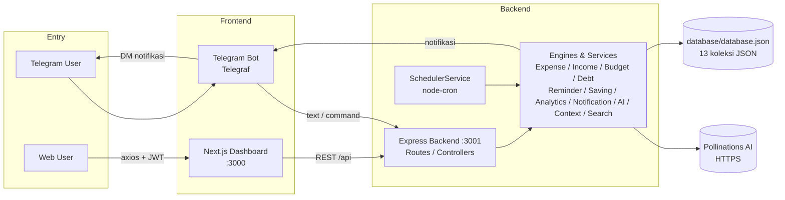
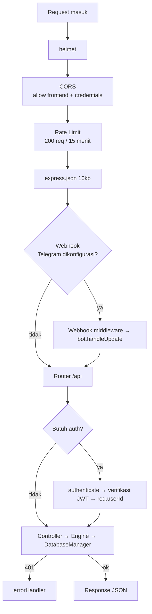
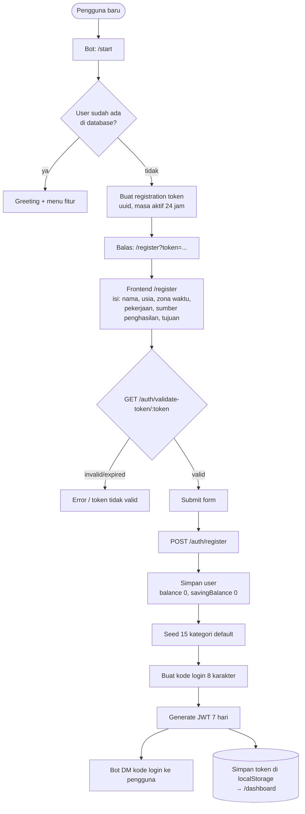
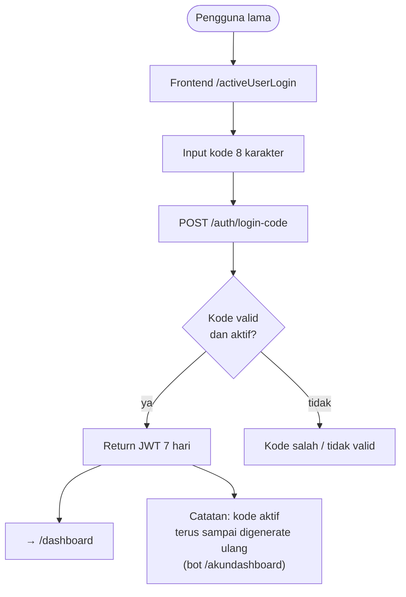
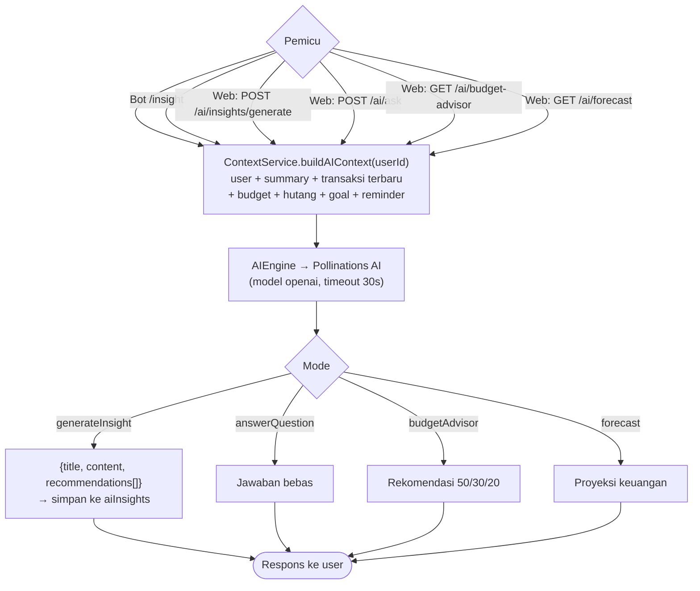
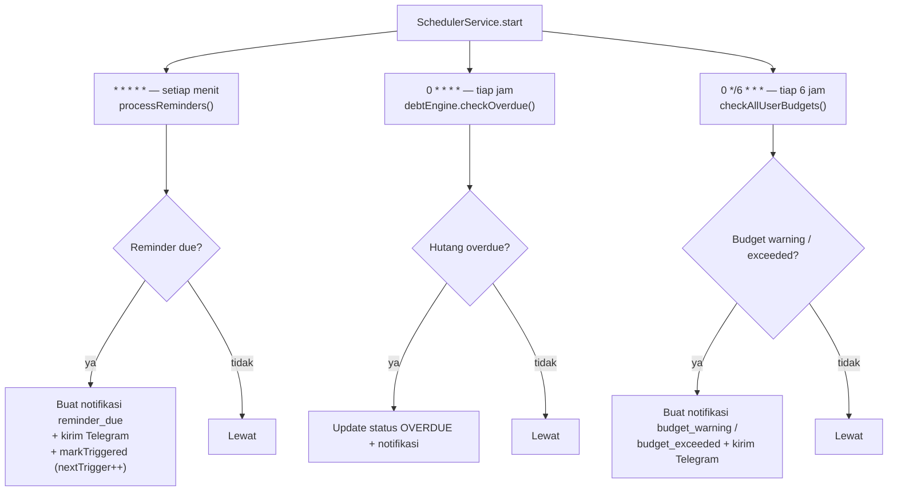
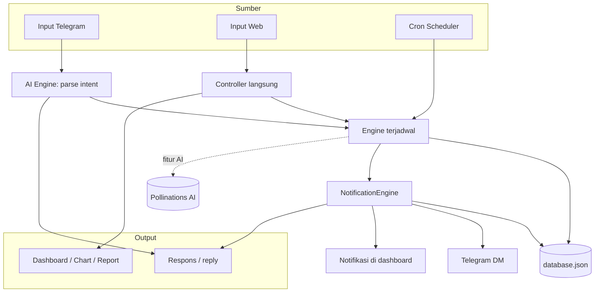
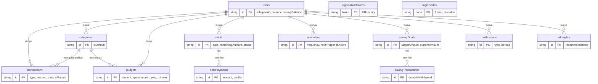

# Flowchart Alur Kerja Aplikasi TemanDuit AI

Dokumen ini menjelaskan alur kerja (workflow) aplikasi **TemanDuit** — asisten keuangan pribadi berbasis AI dengan tiga pintu masuk: **Telegram Bot**, **Web Dashboard (Next.js)**, dan **Scheduler Cron**, yang semuanya terhubung ke satu backend Express dan satu file JSON sebagai database.

---

## 1. Tech Stack

| Layer | Teknologi |
|---|---|
| Backend | Node.js + TypeScript, Express 4, JWT, Zod, node-cron, Telegraf, winston |
| Database | File JSON (`database/database.json`) via `DatabaseManager` (in-memory cache + write queue) |
| AI | Pollinations AI (`https://gen.pollinations.ai/v1/chat/completions`, model `openai`) |
| Frontend | Next.js 14 (App Router), React 18, Tailwind + shadcn/ui, recharts, zustand, axios |
| Bot | Telegraf (polling atau webhook) |

---

## 2. Arsitektur Sistem



**Aliran data inti:** semua input (Telegram maupun web) masuk ke Express API → diproses oleh Engines/Services → menyimpan/membaca `database.json` → untuk fitur AI, konteks pengguna dikirim ke Pollinations AI.

---

## 3. Pipeline Request Backend



---

## 4. Autentikasi & Registrasi

Tidak ada password. Login menggunakan **kode 8 karakter** yang dikirim bot Telegram.





---

## 5. Alur Input Transaksi via Bot Telegram (jalur AI utama)

```mermaid
flowchart TD
    Msg[Pengguna kirim pesan bebas<br/>mis. "makan siang 50rb"] --> Auth{requireAuth?}
    Auth -- belum login --> Hint[Suruh /start atau login]
    Auth -- sudah login --> Parse["AIEngine.parseUserMessage<br/>→ Pollinations AI → JSON action"]
    Parse --> Retry{JSON valid?<br/>(maks 2 retry)}
    Retry -- tidak --> Fallback["Fallback: action = question"]
    Retry -- ya --> Switch{action}

    Switch -- expense --> Exp["recordExpense<br/>+ update balance &amp; category<br/>+ update budget spent"]
    Exp --> Notif1["notifLargeExpense<br/>+ checkBudgetWarnings"]
    Notif1 --> Reply1[Balasan format transaksi + sisa budget]

    Switch -- income --> Inc["recordIncome<br/>+ update balance"]
    Inc --> Reply2[Balasan konfirmasi pemasukan]

    Switch -- debt / receivable<br/>/ installment --> Debt["createDebt"]
    Debt --> Reply3[Balasan konfirmasi hutang/piutang]

    Switch -- saving --> Sav["recordSaving<br/>+ update goal &amp; savingBalance"]
    Sav --> Reply4[Balasan konfirmasi tabungan]

    Switch -- reminder --> Rem["createReminder"]
    Rem --> Reply5[Balasan konfirmasi reminder]

    Switch -- question --> Ans["answerQuestion<br/>dengan konteks keuangan"]
    Ans --> Reply6[Jawaban AI]

    Switch -- unknown --> Help[Pesan bantuan]
```

### Perintah Bot

| Perintah | Fungsi |
|---|---|
| `/start` | Registrasi / greeting |
| `/saldo` | Saldo & tabungan |
| `/ringkasan` | Ringkasan keuangan bulan berjalan |
| `/hutang` | Daftar hutang aktif |
| `/reminder` | Pengingat 30 hari ke depan |
| `/insight` | Insight AI |
| `/tabung [nominal] [ket]` | Catat tabungan cepat |
| `/akundashboard` | Generate ulang kode login web |
| `/bantuan` | Daftar bantuan |

---

## 6. Alur Web Dashboard

```mermaid
flowchart TD
    Login[Login via kode / register] --> Guard[useRequireAuth]
    Guard -- no token --> LoginP[/login]
    Guard -- token ada --> App[AppLayout: Sidebar + Header]
    App --> Poll[Poll jumlah notifikasi tiap 30 detik]
    App --> Search{"Global search (≥ 2 huruf)<br/>→ GET /search"}
    App --> Nav{Pilih menu}

    Nav -- Dashboard --> Dash["GET /dashboard<br/>user + summary + 5 transaksi<br/>+ budget + 5 notifikasi<br/>+ reminder 7 hari + goal<br/>+ top 5 kategori + tren 6 bulan"]
    Nav -- Transaksi --> Tx["GET /transactions (paginated)<br/>CRUD expense"]
    Nav -- Pemasukan --> Inc["GET /transactions<br/>CRUD income"]
    Nav -- Budget --> Bud["GET /budgets<br/>CRUD budget + progress + rollover"]
    Nav -- Hutang --> Debt["GET /debts + /summary<br/>create + recordPayment"]
    Nav -- Reminder --> Rem["GET /reminders + /upcoming<br/>CRUD + toggle aktif"]
    Nav -- Tabungan --> Sav["GET /savings/goals + /summary<br/>create goal + deposit/withdraw"]
    Nav -- Analitik --> Ana["GET /analytics<br/>summary, trends, daily, categories"]
    Nav -- AI Insight --> AIP["GET/POST /ai/insights<br/>POST /ai/ask, /ai/insights/generate<br/>GET /ai/budget-advisor, /ai/forecast"]
    Nav -- Notifikasi --> Not["GET /notifications<br/>mark read / read-all / delete"]
    Nav -- Pengaturan --> Set["Kategori custom CRUD, theme, logout"]
    Nav -- Profil --> Prof["PUT /auth/profile + ringkasan keuangan"]

    Ana --> Charts[Recharts:<br/>CashFlow, Pie, Trend, DailyBar, Heatmap]
```

---

## 7. Alur Fitur AI (Insight, Tanya, Advisor, Forecast)



---

## 8. Scheduler (Cron Jobs)



---

## 9. Alur Lengkap End-to-End (Ringkasan)



**Alur transaksi (bot):** teks → AI parse (JSON action) → engine menyimpan transaksi + update saldo/kategori/budget → notifikasi → balasan Telegram.

**Alur transaksi (web):** form halaman → axios + JWT → controller → engine → database JSON → respons → refresh UI.

**Alur dashboard:** `/dashboard` meng-aggregate banyak engine dalam satu payload → widget & chart.

**Alur laporan:** `/analytics` → `AnalyticsEngine` menghitung summary/trends/daily/category → ditampilkan recharts.

**Alur AI:** request → `ContextService` snapshot data pengguna → `AIEngine` → Pollinations → insight/jawaban (disimpan atau direturn).

---

## 10. Model Data (13 Koleksi)



---

## 11. Catatan Penting

- **Database = 1 file JSON** (`database/database.json`) — tanpa SQL/migrasi; ditulis atomik (temp file + rename) dengan antrian write.
- **Tidak ada password** — login web memakai kode 8 karakter dari bot Telegram; kode aktif terus sampai digenerate ulang.
- Endpoint AI **hardcoded** ke `https://gen.pollinations.ai` di `AIEngine.ts` (tidak memakai `POLLINATIONS_BASE_URL` dari config).
- Seeder membuat **15 kategori default** (`cat-makanan` … `cat-lainnya`) saat registrasi.
- JWT berlaku **7 hari**; rate limit **200 request / 15 menit** pada `/api`.
- `database/hapus_database/index.js` adalah utilitas cleanup manual (bukan bagian runtime aplikasi).
